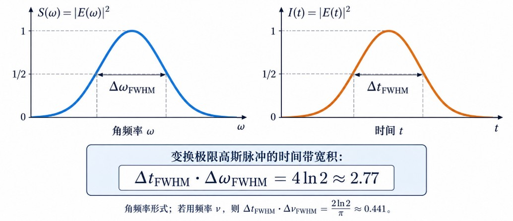
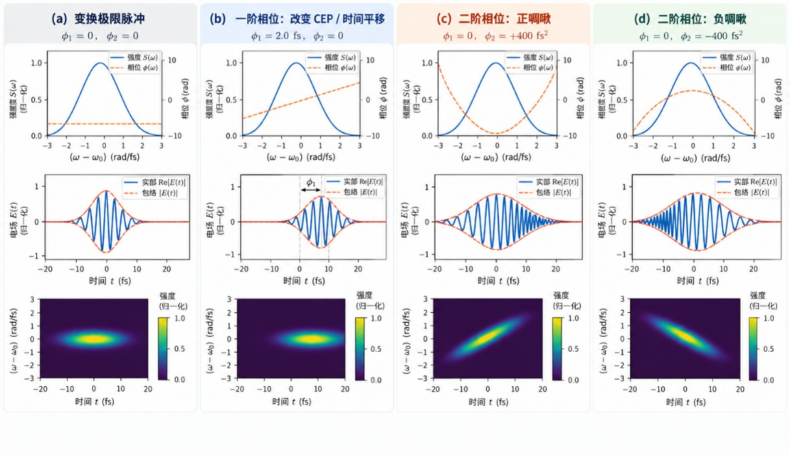

# 超短光脉冲的表征

## 一、时域电场用频域振幅和频域相位的完全表达

约定：时域的相位用 $\phi=\phi(t)$ 表示，频域的相位用 $\varphi=\varphi(\omega)$ 表示；时域相位对时间 $t$ 的导数用 $\dot{\phi}=\mathrm{d}\phi(t)/\mathrm{d}t$ 表示，频域相位对频率 $\omega$ 的导数用 $\varphi'=\mathrm{d}\varphi(\omega)/\mathrm{d}\omega$ 表示。

脉冲的频域强度决定脉冲包含哪些频率，各个频率分量有多强；频域相位决定不同频率分量在时间上如何相干叠加。时域强度是这些频率分量干涉之后的结果，不由频域强度单独决定。

考虑一个沿 $z$ 方向传播的激光脉冲，在固定位置 $z=z_0$ 观察其随时间的变化。电场是复解析信号的实部

$$
E(t)=\operatorname{Re}[\mathcal E(t)]
$$

Fourier 变换约定为

$$
\mathcal E(t)=\frac{1}{2\pi}\int_0^\infty \widetilde{\mathcal E}(\omega)\mathrm{e}^{-\mathrm{i}\omega t}\,\mathrm{d}\omega
$$

其中频域复电场为

$$
\widetilde{\mathcal E}(\omega)=A(\omega)\mathrm{e}^{\mathrm{i}\varphi(\omega)}
$$

频域振幅和频域强度为

$$
A(\omega)=\left|\widetilde{\mathcal E}(\omega)\right|,\qquad S(\omega)=A^2(\omega)
$$

每个频率分量都有自己的振幅 $\sqrt{S(\omega)}$ 和相位 $\varphi(\omega)$，时域复电场是其的相干叠加

$$
\mathcal E(t)=\frac{1}{2\pi}\int_0^\infty\sqrt{S(\omega)}\,\mathrm{e}^{\mathrm{i}[\varphi(\omega)-\omega t]}\,\mathrm{d}\omega
$$

## 二、Fourier 变换受限脉冲情况

在最简单的情况下，首先假设所有频率分量的频域相位都为零 $\varphi(\omega)=0$，那么

$$
\mathcal E(t)=\frac{1}{2\pi}\int_0^\infty \sqrt{S(\omega)}\,\mathrm{e}^{-\mathrm{i}\omega t}\,\mathrm{d}\omega
$$

在频域强度上，设频谱是集中在中心频率 $\omega_0$ 附近的高斯形状

$$
S(\omega)=S_0\exp\left[-\frac{(\omega-\omega_0)^2}{2\sigma_\omega^2}\right]
$$

则频域电场振幅为

$$
A(\omega)=\sqrt{S_0}\exp\left[-\frac{(\omega-\omega_0)^2}{4\sigma_\omega^2}\right]
$$

积分得到

$$
\mathcal E(t)\propto\exp[-\sigma_\omega^2t^2]\exp[-\mathrm{i}\omega t]
$$

所以时域强度分布为

$$
I(t)\propto\exp[-2\sigma_\omega^2t^2]
$$

可见，高斯频域频谱对应高斯时域脉冲。时域脉宽和频域带宽的乘积为
$$
\Delta t_{\mathrm{FWHM}}\Delta\omega_{\mathrm{FWHM}}=4\ln 2
$$

实际上，一个一般脉冲的时域强度 $I(t)$ 的半高全宽 $\Delta t_{\mathrm{FWHM}}$ 与它的 Fourier 变换频谱强度 $S(\omega)$ 的半高全宽 $\Delta\omega_{\mathrm{FWHM}}$ 的乘积（称为时间带宽积）必须大于等于一个常数 $\kappa$，即
$$
\Delta t_{\mathrm{FWHM}}\Delta\omega_{\mathrm{FWHM}}\geq\kappa
$$

$\kappa$ 值依波型而异，但总是 $\mathcal O(1)$ 的常数。

前面已经说到，仅靠频谱强度分布 $S(\omega)$ 不能完全确定时域脉冲形状，还需要知道频域相位 $\varphi(\omega)$。反过来，对于一定的脉冲时域波形 $I(t)$，它的频谱分布不是确定的；或者说，相同 $I(t)$ 的脉冲，并不一定有相同的 $S(\omega)$，这又取决于脉冲的时域相位 $\phi(t)$。当这个相位因子 $\phi(t)$ 为常数时，乘积 $\Delta t_{\mathrm{FWHM}}\Delta\omega_{\mathrm{FWHM}}$ 最小，称这样的脉冲为 Fourier 变换受限脉冲（transform limited pulse, TLP）。而从频域角度来说，对于同样的谱宽 $\Delta\omega_{\mathrm{FWHM}}$，当 $\varphi(\omega)=\mathrm{const}$ 时 Fourier 变换获得的时域脉冲最短。

## 三、频域相位的效果

把一般频域相位在中心频率附近 Taylor 展开，得到

$$
\varphi(\omega)=\varphi_0+\varphi_1(\omega-\omega_0)
+\frac{\varphi_2}{2}(\omega-\omega_0)^2
+\frac{\varphi_3}{6}(\omega-\omega_0)^3+\cdots
$$

其中 $\varphi_i=\left.\mathrm{d}^n\varphi/\mathrm{d}\omega^n\right|_{\omega=\omega_0}$，对应不同阶数的相位，它们对时域脉冲有不同的控制作用。

| 频域相位项  | 物理意义         | 时域作用                   |
| ----------- | ---------------- | -------------------------- |
| $\varphi_0$ | 常数相位         | 改变载波包络相位 CEP       |
| $\varphi_1$ | 一阶相位、群延迟 | 整体平移脉冲               |
| $\varphi_2$ | 二阶相位、GDD    | 产生线性啁啾并展宽高斯脉冲 |
| $\varphi_3$ | 三阶色散 TOD     | 引起非对称脉形、旁瓣等     |

### 3.1 常数相位 $\varphi_0$

电场最强的峰相对于脉冲包络峰值的相位定义为载波包络相位（carrier envelope phase, CEP），常数相位改变载波包络相位，载波包络相位的变化表现为载波在包络下的滑移。

在时域复电场中分离出相对于中心频率的慢变复包络

$$
\mathcal E(t)=a(t)\mathrm{e}^{\mathrm{i}\omega_0t},\qquad
a(t)=|a(t)|\mathrm{e}^{\mathrm{i}\phi(t)}
$$

那么时域实际电场分为快速振荡和缓变包络

$$
E(t)=|a(t)|\cos[\omega_0t-\phi(t)]
$$

时域强度和瞬时角频率为

$$
I(t)\propto |a(t)|^2,\qquad
\omega_{\mathrm{inst}}(t)=\omega_0-\frac{\mathrm{d}\phi(t)}{\mathrm{d}t}
$$

若频域只存在常数相位 $\varphi(\omega)=\varphi_0$，假设原始脉冲（指频域相位设为非零常数前的）是无啁啾、关于 $t=0$ 对称的高斯脉冲

$$
\mathcal E_0(t)=A_t(t)\mathrm{e}^{-\mathrm{i}\omega_0t}
\;\to\; E(t)=A_t(t)\cos\omega_0t
$$

那么引入常数相位后

$$
\mathcal E(t)=\mathcal F\!\left[\widetilde{\mathcal E}(\omega)\right]
=\mathcal F\!\left[A(\omega)\mathrm{e}^{\mathrm{i}\varphi_0}\right]
=\mathrm{e}^{\mathrm{i}\varphi_0}\mathcal E_0(t)
$$

这时真实电场为

$$
E(t)=A_t(t)\cos(\omega_0t-\varphi_0)
$$

由于 $|a(t)|=A_t(t)$，可见常数相位不改变包络。但是快速振荡变为

$$
\cos\omega_0t\;\to\;\cos(\omega_0t-\varphi_0)
$$

即包络不动，但是载波的相位相对于包络有移动。

为什么 $\phi_{\mathrm{CEP}}=-\varphi_0$：设包络峰值在 $t=t_p$，载波相位为 $\theta(t)=\omega_0t-\phi(t)$，这是一般情况。上面已经取 $t_p=0$，且得到了 $\phi(t)=\varphi_0$，因此 $\phi_{\mathrm{CEP}}=-\varphi_0$。

在阿秒脉冲的产生中，只有载波包络相位为零时才能产生单一阿秒脉冲。载波包络相位的变化是相速度和群速度的差造成的，载波的传播速度是相速度 $v_p$，而包络的传播速度是群速度 $v_g$。

### 3.2 一阶相位 $\varphi_1$：整体平移

现在考虑

$$
\varphi(\omega)=\varphi_0+\varphi_1(\omega-\omega_0)
$$

Fourier 变换后得到

$$
\mathcal E(t)
=\frac{1}{2\pi}\int A(\omega)\mathrm{e}^{\mathrm{i}\varphi_0+\mathrm{i}\varphi_1(\omega-\omega_0)}\mathrm{e}^{-\mathrm{i}\omega t}\,\mathrm{d}\omega
=\mathrm{e}^{\mathrm{i}(\phi_0-\omega_0\phi_1)}\mathcal E(t-\varphi_1)
$$

真实电场

$$
E(t)=A_t(t-\varphi_1)\cos[\omega_0(t-\varphi_1)-\varphi_0]
$$

可见效果是包络和载波一起平移 $t\to t-\varphi_1$。

### 3.3 二阶相位 $\varphi_2$：包络展宽和快速振荡疏密变化

把二阶相位考虑在内

$$
\varphi(\omega)=\varphi_0+\varphi_1\Omega+\frac{\varphi_2}{2}\Omega^2,\qquad
\Omega=\omega-\omega_0
$$

频域振幅取高斯型

$$
A(\omega)=A_0\exp\left(-\frac{\Omega^2}{4\sigma_\omega^2}\right)
$$

经过 Fourier 变换，得到

$$
\mathcal E(t)=\sqrt{\frac{A_0^2\sigma_\omega^2}{\pi(1-2\mathrm{i}\varphi_2\sigma_\omega^2)}}
\exp\left[\mathrm{i}(\varphi_0-\omega_0t)
-\frac{\sigma_\omega^2(t-\varphi_1)^2}{1-2\mathrm{i}\varphi_2\sigma_\omega^2}\right]
$$

定义

$$
D=2\varphi_2\sigma_\omega^2
$$

以及相对于脉冲中心的时间为 $u=t-\varphi_1$，上式化简为

$$
\mathcal E(t)=\sqrt{\frac{A_0^2\sigma_\omega^2}{\pi(1-\mathrm{i}D)}}
\exp\left[\mathrm{i}(\varphi_0-\omega_0t)-\frac{\sigma_\omega^2u^2}{1-\mathrm{i}D}\right]
$$

依旧按照包络振幅、包络相位和快速振荡分解，可以写为

$$
\mathcal E(t)
=\sqrt{\frac{A_0^2\sigma_\omega^2}{\pi(1-\mathrm{i}D)}}
\exp\left[-\frac{\sigma_\omega^2u^2}{1-\mathrm{i}D}\right]
\exp(\mathrm{i}\varphi_0)\exp(-\mathrm{i}\omega_0t)
=a(t)\exp(-\mathrm{i}\omega_0t)
$$

对复包络 $a(t)$ 取模得到

$$
|a(t)|=\frac{A_0\sigma_\omega}{\sqrt{\pi}(1+D^2)^{1/4}}
\exp\left[-\frac{\sigma_\omega^2u^2}{1+C^2}\right]
$$

复包络相位为

$$
\arg a(t)=\varphi_0+\frac{1}{2}\arctan D-\frac{D\sigma_\omega^2}{1+D^2}u^2
$$

包络方面，脉冲中心仍为 $t=\varphi_1$，然而包络随 $|D|$ 增大而展宽，具体为

$$
\Delta t=\Delta t_0\sqrt{1+D^2}\qquad (D=2\varphi_2\sigma_\omega^2)
$$

实际电场可以写为

$$
E(t)=|a(t)|\cos\left[\omega_0t-\varphi_0-\frac{1}{2}\arctan D+\frac{D\sigma_\omega^2}{1+D^2}u^2\right]
$$

余弦中出现了 $u^2$ 项，这意味着载波不再以恒定频率振荡。瞬时频率为

$$
\omega_{\mathrm{inst}}(t)=\omega_0+\frac{2D\sigma_\omega^2}{1+D^2}(t-\varphi_1)
$$

所以：$\varphi_2>0$ 时瞬时频率随时间增加，前沿振荡疏、后沿振荡密；$\varphi_2<0$ 反之。除此之外，二阶相位 $\varphi_2$ 也会引入额外的 $\phi_{\mathrm{CEP}}$ 移动（$\arctan D/2$ 项）。

更高的如三阶色散，会带来非对称包络和非线性啁啾，一般会破坏时域强度的对称性，导致主峰不再对称、引起某侧尾部明显等等。

